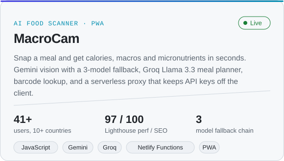
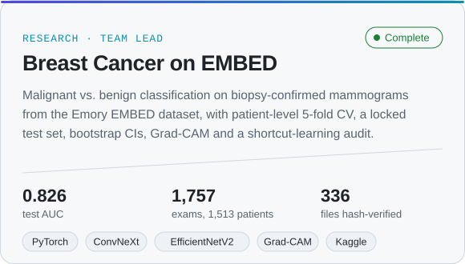
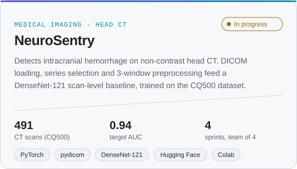
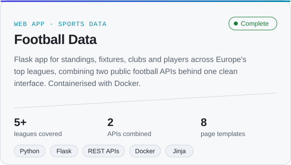

<picture>
  <source media="(prefers-color-scheme: dark)" srcset="assets/header-dark.svg">
  
</picture>

  
  
  

I build production web software and run applied deep-learning research. I'm a final-year Computer Science student at **Southwest Petroleum University** (Chengdu, English-taught program, graduating June 2027), and I'm open to **internships, junior engineering roles and MSc programs**.

- **Now:** Full-stack developer intern at **Terravida Séjours**, building a multi-tenant property-management SaaS (React 19, Django REST, PostgreSQL, Redis, Celery, WebSockets, Docker, AWS).
- **Research:** led a four-person team classifying breast cancer on the Emory **EMBED** mammography dataset, supervised by the SWPU Department of AI.
- **Freelance:** web products for clients in Morocco and China, including a trilingual e-commerce shop and a multilingual digital business card.

### Selected results

<picture>
  <source media="(prefers-color-scheme: dark)" srcset="assets/stats-dark.svg">
  
</picture>

### Featured work

  <a href="https://github.com/Lembachar/macrocam"><picture><source media="(prefers-color-scheme: dark)" srcset="assets/card-macrocam-dark.svg"></picture></a>
  <a href="https://github.com/Lembachar/embed-breast-cancer"><picture><source media="(prefers-color-scheme: dark)" srcset="assets/card-embed-dark.svg"></picture></a>
  <a href="#neurosentry"><picture><source media="(prefers-color-scheme: dark)" srcset="assets/card-neurosentry-dark.svg"></picture></a>
  <a href="https://github.com/Lembachar/football"><picture><source media="(prefers-color-scheme: dark)" srcset="assets/card-football-dark.svg"></picture></a>

<b>Internship and client work</b> (private repositories, details on request)

 

**Terravida Séjours — multi-tenant property-management SaaS** · *Mar 2026 – present*
- Cut a tenant-admin endpoint from 6–7 s to 117 ms by replacing an N+1 query with a correlated subquery.
- Shrank the main JavaScript bundle from 501 KB to 152 KB; the dashboard loads in about 130 ms.
- Fixed a calendar that silently dropped bookings past 500 a month (tested with 780; payload 136 KB → 3 KB).
- Closed two data leaks (cross-tenant user search, guest contact details) and added server-enforced role permissions on every endpoint.
- Grew backend tests from 86 to 271; load-tested 100 concurrent users on 28,500+ properties with 0 errors.

**Moroccan e-commerce shop** · *sole developer, Oct 2026 – present*
- Django REST + Next.js 16, French / Arabic (RTL) / English, staff TOTP 2FA, Argon2id, CSP, Cloudflare Turnstile.
- 302 backend + 92 frontend tests; k6 load tests took throughput from 43 to 140 req/s and search at 5,000 products from 1.3 s to 64 ms.

### Research

**[Breast cancer classification on EMBED](https://github.com/Lembachar/embed-breast-cancer): a deep-learning study on the Emory Breast Imaging Dataset** · *team lead, Sep – Nov 2026* · [report (PDF)](https://github.com/Lembachar/embed-breast-cancer/blob/main/report/EMBED_breast_cancer_report.pdf)\
Malignant vs. benign on 1,757 biopsy-confirmed exams from 1,513 patients. ResNet-50, EfficientNetV2-S and ConvNeXt-Tiny with patient-level 5-fold cross-validation and a locked test set. Test AUC went from 0.776 (images only) to **0.826 (95% CI 0.779–0.872)** with clinical context. Also found an exam-type shortcut in the BI-RADS task, and ran marker-inpainting and Grad-CAM checks. Results and figures, including de-identified mammograms, are published with written approval from Dr. Hari Trivedi, Co-director of the Emory HITI Lab, which maintains the EMBED dataset.

**NeuroSentry: intracranial hemorrhage detection on head CT** · *phase 1 · paused*\
The team's first medical-imaging project, on the CQ500 dataset (491 non-contrast head CTs with three-radiologist labels). We built and validated the full pipeline (DICOM loading, series selection, three-window preprocessing, DenseNet-121 baseline), then carried the same methods into phase 2, the EMBED mammography study above.

### Toolbox

<picture>
  <source media="(prefers-color-scheme: dark)" srcset="assets/stack-dark.svg">
  
</picture>

Also: Django REST Framework · Celery · Django Channels · TanStack Query · pytest · Vitest · k6 · Locust · Cloudflare · Netlify · i18n / RTL

### Education

**B.Sc. Computer Science and Technology** — Southwest Petroleum University, Chengdu · *2023 – 2027* · taught in English

- **Certificates:** IBM *Developing AI Applications with Python and Flask* · IBM *Databases and SQL for Data Science with Python* · Meta *Introduction to Front-End Development*
- **Languages:** Arabic (native) · English (fluent) · French (intermediate) · Mandarin (basic)

---

Open to internships, junior roles and MSc programs for 2027 · <a href="mailto:lembacharimad@gmail.com">lembacharimad@gmail.com</a>

